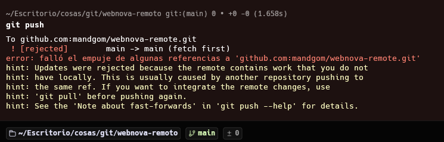
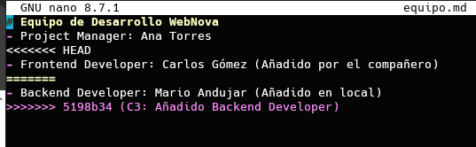
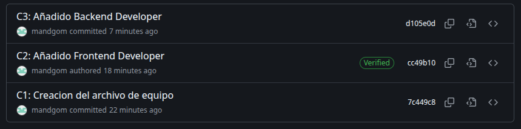

# Practica 5
## Captura 1

Git rechaza al subir, en hint indica que el repositorio tiene cambios que en local no tengo y los tengo que integrar con un "git pull"

## Captura 2

Aqui se ve el nano con las marcas, las borro y ejecuto "git rebase --continue"

## Captura 3

Aqui se ve los commits limpios

---

**Porque git bloqueo mi subida en la Fase 3**

Porque el repositorio de Github y el de mi ordenador se habian separado, mi compañero "virtual" subio un commit a github y yo otro commit diferente en local sin saber descargado el del compañero virtual.

**Que ventaja tiene usar git pull --rebase en lugar de un simple git pull en estos casos?**

"git pull" descarga los cambios y los juntas con los mios locales, crea un commit extra con una separacion en la rama.

"git pull --rebase" descarga los cambios del compañero virtual y despues coloca mi commit por encima, lo sobrescribe, en la rama no se divide, sigue con la misma rama como si yo lo siguiera. 
